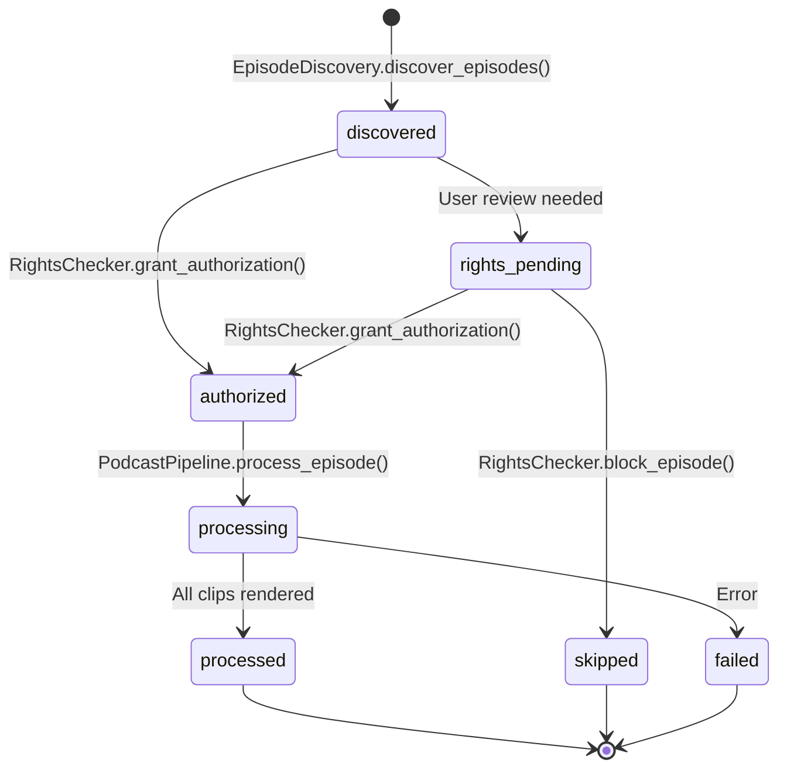
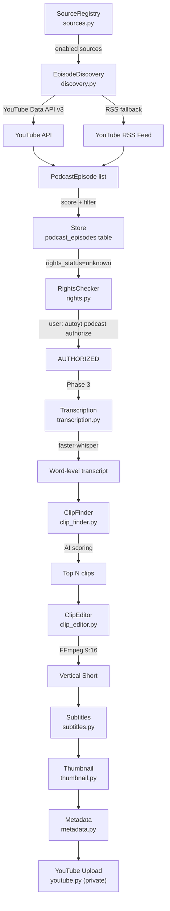
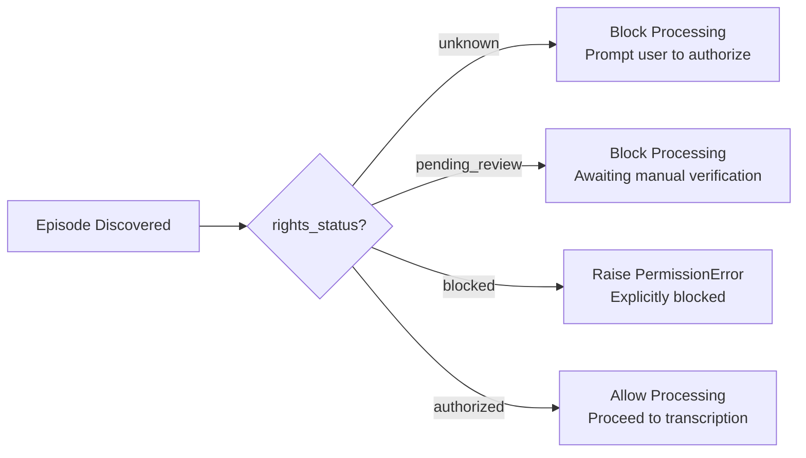

# Automated Podcast Clipping Platform — Architecture Document

> **AutoYT → Podcast Clips Transformation**  
> Status: Phase 1 & 2 implemented (source registry, episode discovery, rights layer, DB schema, CLI commands)

---

## 1. Executive Summary

AutoYT is being transformed from a tech-news Shorts pipeline into an **Automated Podcast Clipping Platform** that:

1. Discovers podcast episodes from configured Indian creators (Raj Shamani, Ranveer Allahbadia, Nikhil Kamath)
2. **Mandatory rights verification** before any processing
3. Transcribes authorised audio with faster-whisper
4. Uses AI to identify the best ~60-second clips
5. Edits clips into 9:16 vertical Shorts with subtitles
6. Uploads privately to YouTube for manual review

The transformation preserves the proven infrastructure and extends it with a new `podcast/` package that is entirely independent of the original news pipeline.

---

## 2. Existing Module Inventory

### 2.1 Modules Reused As-Is

| Module | Why Reused |
|--------|-----------|
| `store.py` | SQLite persistence layer — extended with 3 new tables via schema migration 3 |
| `youtube.py` | OAuth service, resumable upload, metadata generation — used for clip upload |
| `youtube_oauth.py` | Browser-based OAuth flow — no changes needed |
| `net.py` | Bounded HTTPS client (`Web`) — used for RSS feed fetching in discovery fallback |
| `licensing.py` | License audit framework — will apply to thumbnail/clip assets |
| `scheduling.py` | APScheduler integration — can schedule periodic podcast discovery |
| `dashboard.py` | HTTP server + ThreadPoolExecutor — reused for podcast dashboard section |

### 2.2 Modules Extended

| Module | Extension |
|--------|-----------|
| `config.py` | Add `YOUTUBE_DATA_API_KEY`, `PODCAST_SOURCES_FILE`, `PODCAST_DISCOVERY_DAYS`, `PODCAST_MAX_CLIP_DURATION_SECONDS`, `WHISPER_MODEL` settings |
| `cli.py` | Add `podcast` subcommand group with `sources`, `discover`, `episodes`, `authorize`, `clips` sub-commands |
| `store.py` | Schema migration 3: `podcast_sources`, `podcast_episodes`, `podcast_clips` tables + 8 new helper methods |
| `dashboard.py` | Add `/api/podcast/*` endpoints and podcast section to snapshot |

### 2.3 New Package: `src/autoyt/podcast/`

| File | Purpose |
|------|---------|
| `__init__.py` | Package marker |
| `sources.py` | `PodcastSource` dataclass + `SourceRegistry` (JSON-backed, 3 built-in creators) |
| `discovery.py` | `PodcastEpisode` dataclass + `EpisodeDiscovery` (YouTube Data API + RSS fallback) |
| `rights.py` | `RightsRecord` + `RightsChecker` — mandatory gate before any processing |
| `transcription.py` *(Phase 3)* | faster-whisper audio transcription pipeline |
| `clip_finder.py` *(Phase 3)* | AI-powered clip scoring and candidate selection |
| `clip_editor.py` *(Phase 3)* | FFmpeg-based vertical 9:16 clip editing |
| `subtitles.py` *(Phase 3)* | ASS subtitle generation (reusing `video.py` patterns) |
| `thumbnail.py` *(Phase 3)* | Thumbnail generation from podcast frame |
| `metadata.py` *(Phase 3)* | Title/description/hashtag generation for clips |
| `pipeline.py` *(Phase 3)* | Orchestrates all stages end-to-end |

---

## 3. Database Schema

### 3.1 New Tables (Migration 3)

```sql
CREATE TABLE IF NOT EXISTS podcast_sources (
    id TEXT PRIMARY KEY,
    name TEXT NOT NULL,
    show_name TEXT NOT NULL,
    youtube_channel_id TEXT,
    enabled INTEGER NOT NULL DEFAULT 1,
    config_json TEXT NOT NULL,
    created_at TEXT NOT NULL,
    updated_at TEXT NOT NULL
);

CREATE TABLE IF NOT EXISTS podcast_episodes (
    id TEXT PRIMARY KEY,           -- source_id:video_id
    source_id TEXT NOT NULL,
    video_id TEXT NOT NULL,
    video_url TEXT NOT NULL,
    title TEXT NOT NULL,
    channel_name TEXT NOT NULL DEFAULT '',
    published_at TEXT NOT NULL,
    duration_seconds INTEGER,
    thumbnail_url TEXT,
    description TEXT,
    discovery_score REAL,
    topics_matched TEXT,           -- JSON array
    status TEXT NOT NULL DEFAULT 'discovered',
    -- Status values: discovered | rights_pending | authorized | processing | processed | skipped | failed
    rights_status TEXT NOT NULL DEFAULT 'unknown',
    rights_basis TEXT,
    rights_notes TEXT,
    rights_verified_at TEXT,
    discovered_at TEXT NOT NULL,
    processed_at TEXT,
    error_message TEXT,
    UNIQUE(source_id, video_id)
);

CREATE TABLE IF NOT EXISTS podcast_clips (
    id TEXT PRIMARY KEY,           -- episode_id:clip_index
    episode_id TEXT NOT NULL,
    source_id TEXT NOT NULL,
    clip_index INTEGER NOT NULL,
    start_seconds REAL NOT NULL,
    end_seconds REAL NOT NULL,
    duration_seconds REAL NOT NULL,
    transcript_text TEXT,
    ai_score REAL,
    score_breakdown TEXT,          -- JSON
    generated_title TEXT,
    generated_description TEXT,
    hashtags TEXT,                 -- JSON array
    status TEXT NOT NULL DEFAULT 'candidate',
    -- Status values: candidate | approved | rejected | processing | rendered | uploaded | failed
    output_path TEXT,
    thumbnail_path TEXT,
    youtube_video_id TEXT,
    youtube_url TEXT,
    upload_status TEXT,
    review_notes TEXT,
    created_at TEXT NOT NULL,
    updated_at TEXT NOT NULL,
    FOREIGN KEY(episode_id) REFERENCES podcast_episodes(id)
);
```

### 3.2 Episode Status State Machine



---

## 4. Data Flow Architecture



---

## 5. New `.env` Settings Needed

```dotenv
# ── Podcast Platform ─────────────────────────────────────────────────────────

# YouTube Data API v3 key (for episode discovery without OAuth)
# If not set, falls back to existing OAuth token for discovery
YOUTUBE_DATA_API_KEY=

# Path to podcast sources override JSON (default: data/podcast_sources.json)
PODCAST_SOURCES_FILE=data/podcast_sources.json

# How many days back to look for new episodes (default: 30)
PODCAST_DISCOVERY_DAYS=30

# Maximum clip duration to extract in seconds (default: 90)
PODCAST_MAX_CLIP_DURATION_SECONDS=90

# Target clip duration in seconds (default: 60)
PODCAST_TARGET_CLIP_DURATION_SECONDS=60

# faster-whisper model size: tiny | base | small | medium | large-v3
WHISPER_MODEL=base

# Maximum number of clip candidates to extract per episode (default: 5)
PODCAST_CLIPS_PER_EPISODE=5

# Output directory for podcast clips (default: output/podcast)
PODCAST_OUTPUT_DIR=output/podcast
```

---

## 6. New CLI Commands

```
# List configured podcast sources
autoyt podcast sources

# Discover recent episodes from all enabled sources
autoyt podcast discover [--source SOURCE_ID]

# List discovered episodes
autoyt podcast episodes [--status STATUS] [--source SOURCE_ID]

# Grant explicit rights authorisation before processing
autoyt podcast authorize EPISODE_ID --basis BASIS [--evidence-url URL] [--notes TEXT]

# List generated clips
autoyt podcast clips [--episode EPISODE_ID] [--status STATUS]
```

---

## 7. New Dashboard API Endpoints (Phase 3+)

| Endpoint | Method | Purpose |
|----------|--------|---------|
| `/api/podcast/sources` | GET | List configured sources |
| `/api/podcast/episodes` | GET | List episodes with optional status/source filter |
| `/api/podcast/episodes/:id` | GET | Episode detail + clips |
| `/api/podcast/authorize` | POST | Grant/block rights for an episode |
| `/api/podcast/clips` | GET | List clips with optional filters |
| `/api/podcast/clips/:id/approve` | POST | Approve a clip for upload |
| `/api/podcast/discover` | POST | Trigger manual discovery run |

---

## 8. Rights Verification Design

> [!IMPORTANT]
> **No podcast audio or video is ever processed without an explicit `AUTHORIZED` rights record.**
> The `RightsChecker.check_before_processing()` method is a hard gate — it raises `PermissionError`
> when blocking, and returns `(False, reason)` when pending, ensuring zero ambiguity.

### Rights Basis Values

| Basis | Meaning |
|-------|---------|
| `creator_permission` | Direct permission from the creator (email, DM, etc.) |
| `cc_license` | Content published under a Creative Commons license |
| `public_domain` | Content in the public domain |
| `fair_use_claimed` | User believes fair use applies (legal review recommended) |
| `other` | Other documented basis (see notes field) |

### Rights Flow



---

## 9. Pre-configured Sources

> [!NOTE]
> Channel IDs below are **placeholders** and must be verified against the actual
> YouTube channel pages before running live discovery.  Edit `data/podcast_sources.json`
> to correct them without touching code.

| Creator | Show | Channel ID (TODO: verify) |
|---------|------|--------------------------|
| Raj Shamani | Figuring Out | `UCxVfMH7JNfKCFTbfpBQG1dQ` |
| Ranveer Allahbadia | The Ranveer Show | `UCGHZpIpYTGEDiNFbdMDFe-A` |
| Nikhil Kamath | WTF is | `UCF6a_lZ1GufQFmFb7HRiVJQ` |

---

## 10. Phase Roadmap

| Phase | Deliverable | Status |
|-------|-------------|--------|
| **Phase 1** | Source registry, episode discovery, DB schema, CLI | ✅ **Done** |
| **Phase 2** | Rights verification layer, `RightsChecker` | ✅ **Done** |
| Phase 3 | faster-whisper transcription pipeline | 🔲 Planned |
| Phase 4 | AI clip finder + scoring | 🔲 Planned |
| Phase 5 | FFmpeg clip editor + ASS subtitles | 🔲 Planned |
| Phase 6 | Thumbnail generation + metadata | 🔲 Planned |
| Phase 7 | Private YouTube upload + dashboard | 🔲 Planned |

---

## 11. Key Design Decisions

1. **Non-destructive extension**: The original video pipeline remains fully functional. The `podcast/` package is a separate namespace; existing commands/tables are untouched.

2. **Config-first channel IDs**: Channel IDs are never hardcoded in logic — always loaded from `data/podcast_sources.json`. This allows correction without code deploys.

3. **Rights-first architecture**: `RightsChecker` is a mandatory gate with no bypass. Processing without explicit authorisation is architecturally impossible.

4. **YouTube Data API + RSS dual-path**: API key enables richer metadata and duration data; RSS fallback ensures discovery works even without a key.

5. **Reuse `youtube.py` for uploads**: Phase 7 clip uploads use the existing resumable upload infrastructure with the same session safety guarantees.

6. **Store-centric state**: All episode/clip state lives in SQLite (same `autoyt.db`), enabling the dashboard to monitor podcast jobs alongside existing video jobs.
